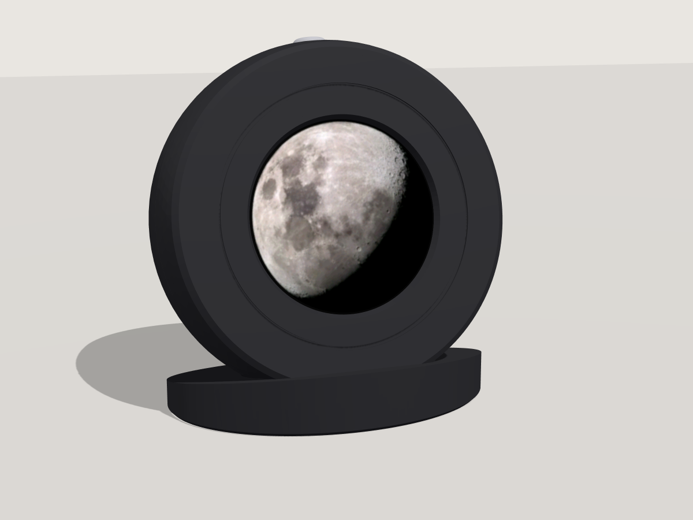
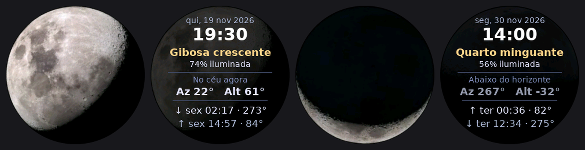
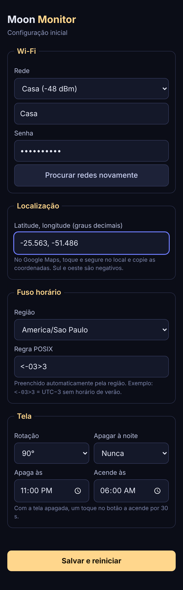
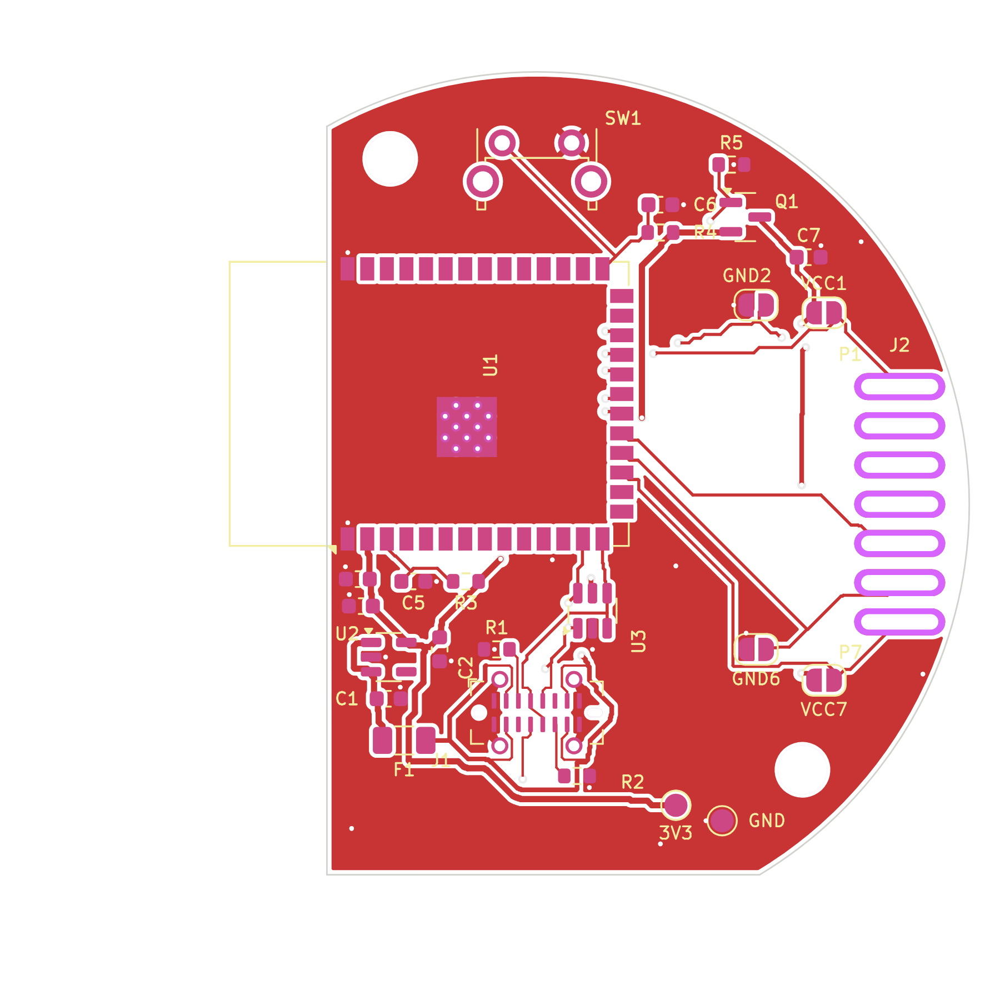
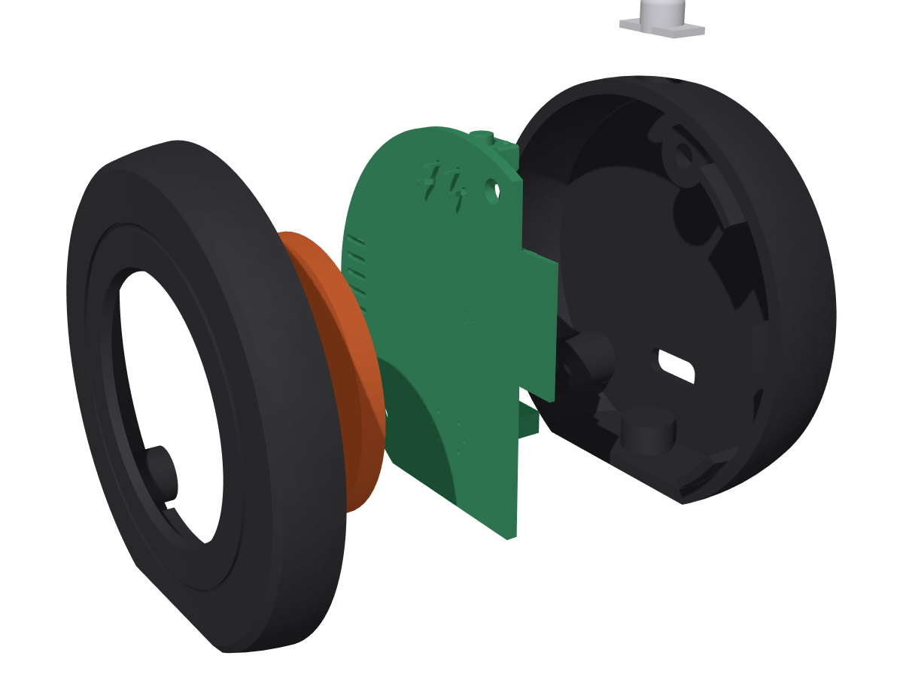
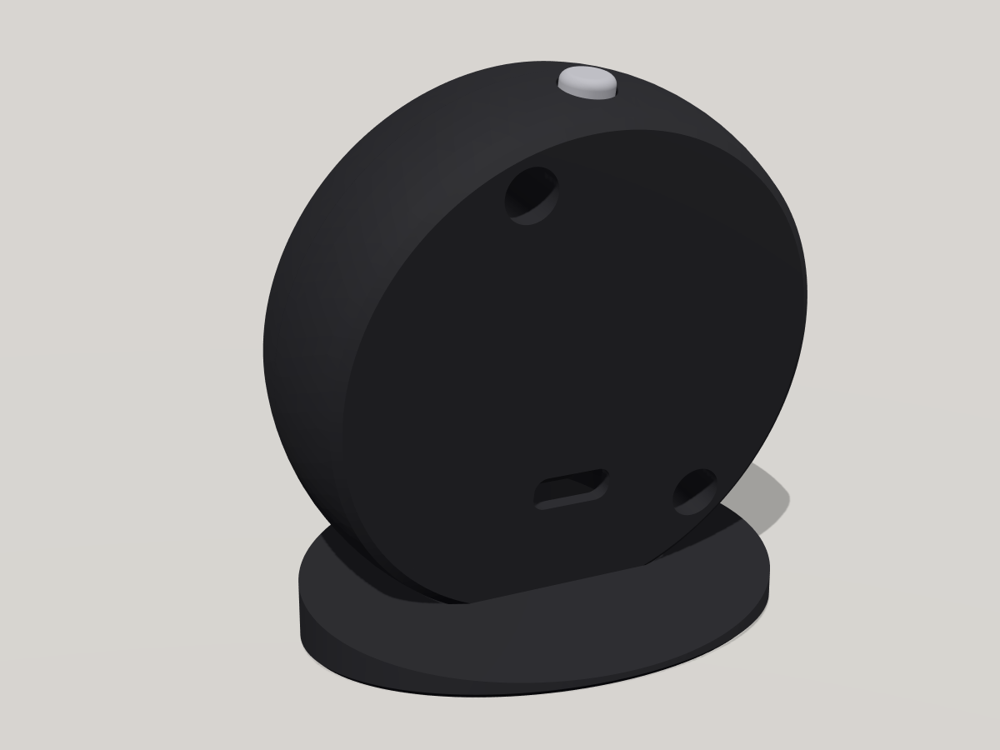

# Moon Monitor v2

Enfeite de mesa que mostra a Lua **na fase e na orientação exatas** em que ela está no céu do local configurado, usando os quadros de fases da NASA. Reprojeto completo do Moon Monitor original (Raspberry Pi Zero): agora é um ESP32-S3 em uma placa própria de Ø56 mm, dentro de um corpo de Ø62 × 20 mm.




| | v1 (Raspberry Pi) | v2 |
|---|---|---|
| Processador | Pi Zero 2W + cartão SD + Linux | ESP32-S3-WROOM-1-N16R8 |
| Ligação | jumpers | PCB dedicado, display soldado direto |
| Alimentação | micro-USB do Pi | USB-C fêmea na traseira (também grava o firmware) |
| Configuração | editar `main.py` | página web na rede Wi-Fi do próprio gadget |
| Partida | ~40 s, exige desligamento seguro | poucos segundos (estimado), pode tirar da tomada |
| Consumo | ~1 W | ~0,4 W (estimado) |

## Funcionamento

- **Tela da Lua** – quadro da NASA cuja iluminação casa com a Lua real, girado para que o limbo iluminado e o relevo fiquem como no céu (zênite = topo da tela). Lua baixa fica alaranjada; abaixo do horizonte fica escurecida e azulada.
- **Toque curto** – tela de informações: data e hora, fase, % iluminada, azimute e altura, e os dois próximos eventos com hora e azimute (nascer → pôr se a Lua está oculta; pôr → nascer se está visível). Volta sozinha em 30 s, ou com outro toque.
- **Segurar 5 s** – abre o portal de configuração (também abre sozinho na primeira vez, ou se o Wi-Fi não conectar em 90 s). A tela mostra um QR code; a rede `MoonMonitor-XXXX` é WPA2 com senha aleatória por aparelho. A página configura Wi-Fi, coordenadas, fuso horário, rotação da tela e desligamento noturno opcional. Fecha em 10 min ou com um toque.



## Conteúdo

| Pasta | O quê |
|---|---|
| `hardware/` | Projeto KiCad 7 (`moonmonitor.kicad_pcb/.kicad_sch`) e `fab/`: Gerbers, BOM e CPL no formato JLCPCB, PDF do esquemático, STEP da placa, relatório de DRC |
| `hardware/gen/` | Scripts que geram tudo acima a partir de uma única netlist (`design.py`) |
| `case/` | `build_case.py` (CadQuery, paramétrico), `stl/` prontos para imprimir, STEP da montagem |
| `firmware/` | Projeto PlatformIO; `data/m/` são os 237 quadros da Lua em JPEG (2 MB) |
| `tools/` | Conversão dos quadros (`build_assets.py`) e das fontes (`make_font.py`) |

## Eletrônica



Placa de 2 camadas, 1,6 mm, todos os SMD em um lado só (montagem econômica). Mínimos: trilha/espaço 0,15 mm, furo 0,3 mm.

| Ref | Peça | Função |
|---|---|---|
| U1 | ESP32-S3-WROOM-1-N16R8 | MCU + Wi-Fi, USB nativo (sem conversor serial) |
| J1 | USB-C vertical GT-USB-7051A (16 pinos, 10,5 mm) | sai reto pela traseira; dados ligados para gravação |
| F1, U3 | PTC 0,5 A, USBLC6-2SC6 | proteção contra curto e ESD na entrada |
| R1, R2 | 5,1 kΩ | CC1/CC2: funciona com qualquer carregador ou cabo C-C |
| U2 | AP2112K-3.3 | regulador 3,3 V / 600 mA |
| Q1, R5 | AO3401A, 100 kΩ | corta a alimentação do display (modo noturno) |
| SW1 | PTS645VL39-2 (ângulo reto, PTH) | botão no topo; é também o BOOT do ESP32 |
| J2 | 7 rasgos metalizados | recebe a barra de pinos do próprio módulo GC9A01 |

Lista completa com códigos LCSC em [`hardware/fab/bom.csv`](hardware/fab/bom.csv); esquemático em [`hardware/fab/schematic.pdf`](hardware/fab/schematic.pdf).

### Display e os jumpers de solda

A placa foi feita para o módulo GC9A01 redondo de **7 pinos** do projeto original (`RST CS DC SDA SCL GND VCC`). Como não dá para saber de que lado fica o VCC quando o módulo está encaixado, as 7 posições vão para GPIOs e quatro jumpers de solda escolhem a alimentação:

| Olhando a placa por trás, de P1 (em cima) a P7 | Fechar | `DISPLAY_REVERSED` em `config.h` |
|---|---|---|
| `RST CS DC SDA SCL GND VCC` | `GND6` + `VCC7` | `0` |
| `VCC GND SCL SDA DC CS RST` | `VCC1` + `GND2` | `1` |

Feche **apenas um par**. Fechar os dois coloca 3,3 V em curto com o GND.

## Case




Quatro peças, sem suportes: `front_shell` (face para a mesa), `rear_shell` (traseira para a mesa), `button`, `stand`. PLA ou PETG, camada 0,2 mm, 3 paredes. Ferragens: 3 insertos M3 a quente (OD 4,2–4,6 × 4 mm) e 3 parafusos M3×8 (2 fecham o corpo prensando a placa, 1 prende a base). Sem insertos: `INSERT_D = 2.6` no script e rosqueie direto no plástico.

## Montagem

1. Encomende a placa com montagem SMT (`moonmonitor-gerbers.zip`, `bom.csv`, `cpl.csv`). Solde SW1 à mão.
2. Coloque os insertos: dois nas torres da tampa frontal, um no fundo da tampa traseira.
3. Apoie o display na tampa frontal, vidro para a janela e aba dos pinos para o lado sem arco de encaixe.
4. Encaixe a placa sobre as torres, com os pinos do display atravessando os rasgos de J2, e prenda provisoriamente com os dois parafusos.
5. Com o display encostado na frente, solde os 7 pinos e feche o par de jumpers correto.
6. Solte os parafusos, ponha o botão no furo da tampa traseira (por dentro), feche o corpo e aperte os dois parafusos por trás.
7. Parafuse a base por baixo.

## Firmware

```sh
cd firmware
pio run -t upload      # firmware
pio run -t uploadfs    # imagens da Lua
```

Na primeira gravação, segure o botão enquanto conecta o USB (modo download) e reconecte depois. Se a imagem aparecer deitada, mude a **Rotação** na página de configuração.

## O que foi verificado e o que não foi

Verificado nesta sessão:

- **Astronomia** (`firmware/test/compare_ephem.py`, 600 instantes, 8 locais, 2026–2032, contra PyEphem): azimute e altura 0,005°, ângulo do limbo 0,03°, iluminação 0,25 %, nascer/pôr 7 s.
- **Telas**: as imagens acima saem do mesmo código de desenho do firmware, compilado no PC (`firmware/test/sim.py`).
- **Página de configuração**: testada em Chromium (detecção de fuso, validação e envio).
- **PCB**: DRC do KiCad sem violações elétricas e sem conexões faltando; netlist do esquemático idêntica à da placa.
- **Case**: interferência zero entre as peças impressas e o modelo 3D da placa montada.

**Não** verificado, confira antes de gastar dinheiro:

- **O firmware não foi compilado para o ESP32** (o ambiente não tinha acesso ao toolchain). `main.cpp` só passou por checagem de sintaxe contra stubs (`firmware/test/check_syntax.sh`); as chamadas de LovyanGFX/WiFi/WebServer podem precisar de ajuste na primeira compilação.
- **Nada foi fabricado nem testado em bancada.**
- **Dimensões do módulo de display foram estimadas** (não achei desenho confiável do módulo de 7 pinos): PCB Ø36 mm, 3,2 mm de espessura, pinos a 21–26 mm do centro (os rasgos de J2 cobrem essa faixa), barra de 7 pinos centrada. Meça o seu e ajuste o primeiro bloco de `case/build_case.py`; se os pinos caírem fora da faixa, mude `J2` em `hardware/gen/design.py` e regenere.
- **Altura do J1 (10,5 mm)** veio de listagens de distribuidores, não do datasheet. Ela define a profundidade do case.
- **Códigos LCSC** foram escritos de memória: confira cada um, o estoque e a rotação das peças na pré-visualização do JLCPCB. F1 está sem código.
- **Antena**: fica em balanço fora da placa, mas a 4 mm do metal do display. Deve bastar dentro de casa; não foi medido.

## Regenerar

```sh
python3 tools/build_assets.py && python3 tools/make_font.py            # imagens e fontes
cd hardware/gen && /usr/bin/python3 build_pcb.py && python3 build_sch.py && python3 export_fab.py   # KiCad 7
cd case && python3 build_case.py                                       # pip install cadquery
```

Imagens da Lua: NASA Scientific Visualization Studio. Fonte: DejaVu Sans.
